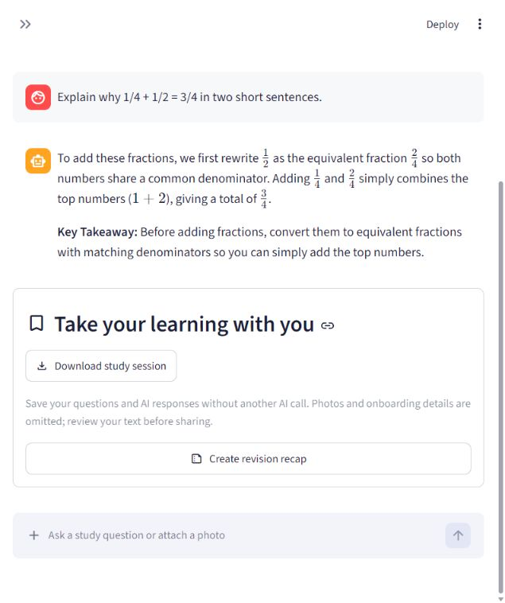

# Snap & Study

Upload a study question or photo, work through hints and follow-ups, practise with a quiz, and save a revision record.

**Portfolio work sample — built with substantial Codex assistance.** This repository is a reviewed source/evidence snapshot. It has fresh Git history to avoid carrying over private development metadata. Source publication is not a new app deployment.



## Review the work

- [Purpose, contribution and limitations](ACADEMY-WORK.md)
- [Verification details](STUDY-FLOW-RESULTS.md)
- [Privacy review](PRIVACY-REVIEW.md)

16 automated tests with mocked providers; a separate real browser photo-to-quiz-to-recap flow and real session-download check.

## Attribution

The applicant directed requirements and requested useful, measurable results. Codex substantially implemented, debugged and executed the recorded checks. No independent authorship, user adoption or guaranteed admissions outcome is claimed. The applicant should describe their own decisions and learning in their own words.

## Setup and original documentation

# Snap & Study

A Streamlit study companion powered by Gemini text and vision. Upload a question,
diagram, or notes, ask follow-ups, practise with hints/quizzes, then review and
send a revision recap to Telegram.

## Project structure

```text
snap-and-study/
├── app.py                     # Streamlit app, onboarding, and study chat
├── prompts.py                 # AI personality and revision recap prompts
├── services.py                # Input validation and Telegram delivery
├── telegram_setup.py          # Helper to find your Telegram chat ID
├── requirements.txt           # Python dependencies
├── README.md                  # Setup, usage, and deployment guide
├── .gitignore                 # Excludes real secrets and local generated files
├── .streamlit/
│   ├── config.toml            # Theme and upload settings
│   └── secrets.toml.example   # Copy to secrets.toml and add your own keys
└── tests/
    └── test_project.py        # Automated app and integration checks
```

The local project folder is `D:\macropro`; the folder name does not affect the
app. The private `.streamlit/secrets.toml`, `venv/`, and submission ZIP are local
files excluded from GitHub. Telegram replaces the guide's WhatsApp action tool.

## Run locally

Use Python 3.12 or newer. In Windows PowerShell:

```powershell
python -m venv venv
.\venv\Scripts\python.exe -m pip install -r requirements.txt
Copy-Item .streamlit\secrets.toml.example .streamlit\secrets.toml
# Edit secrets.toml; don't replace an existing configured file.
.\venv\Scripts\python.exe -m streamlit run app.py
```

On macOS/Linux, use python3 and venv/bin/python. Configure GEMINI_API_KEY from
[Google AI Studio](https://aistudio.google.com/apikey). GEMINI_MODEL defaults to
gemini-3.5-flash and can be changed to a text-and-image model available to your key.

## Connect Telegram

1. Open [@BotFather](https://t.me/BotFather) in Telegram, send /newbot, and follow
   its instructions. Save the supplied token as TELEGRAM_BOT_TOKEN in your private
   .streamlit/secrets.toml. Never put it in the repository or browser address bar.
2. Open your new bot in Telegram and press Start or send /start. Bots cannot
   initiate a private conversation before a user contacts them.
3. Run the local helper to find recent private chat IDs:

```powershell
.\venv\Scripts\python.exe telegram_setup.py
```

4. Enter your name and numeric Telegram chat ID in the app. A phone number or
   @username is not a chat ID. Choose your own chat from the helper output.
5. Ask a study question or upload a JPG/PNG, create a recap, review it, and click
   Send recap to Telegram. The recap and your name are sent to that chat.

The helper reads recent bot messages without consuming them. If no chat appears,
send /start again. A bot configured with a webhook cannot use getUpdates at the
same time; use a dedicated bot for this app. The app uses Python's built-in HTTP
client and requires no Telegram SDK. See the [Bot API](https://core.telegram.org/bots/api)
and [bot FAQ](https://core.telegram.org/bots/faq).

## Features and privacy

- Text/photo chat with memory for the browser session.
- Step-by-step explanations, hints, and one-question quizzes.
- Telegram is optional: start with only a name and AI-processing consent, then
  download a recap. Add or correct the delivery chat ID later in the sidebar.
- JPG/PNG validation and a 10 MB upload limit.
- Scoped academic prompts that request clearer photos when content is unreadable.
- Recap preview, download, and Telegram sending with duplicate-send protection.
- Full study-session Markdown download, with no extra AI call. It excludes the
  personalized welcome, onboarding fields and photo files. Student-written text
  may still contain personal information; review it before sharing.
- Specific authentication errors and explicit retry/discard for failed questions.
- Each session allows at most 12 successful study messages and 15 MiB of stored
  photos, with a 10 MiB limit per photo. Limits are checked before provider calls;
  at the message limit, recap creation/download remains available. Start a new
  session after saving your recap. These are per-session bounds, not a global
  quota, an OS memory cap, or protection against many simultaneous users.
- Each tutoring/recap response has a 2,048-token output budget. It may still be
  truncated; the app does not establish factual accuracy or learning outcomes.

Gemini receives questions/photos. Telegram receives the recap, name, and selected
chat ID only when you click Send. The app stores conversations in session state,
not a database. AI answers may be wrong; verify them against course materials.
Recaps are limited to 1,500 characters. API quotas apply. A successful Telegram
API response confirms message creation, not that the recipient has read it.

## Tests

```powershell
.\venv\Scripts\python.exe -m unittest discover -s tests -v
```

Sixteen automated checks cover onboarding/reset, optional Telegram and later chat
changes, text/photo history, learning-mode forwarding, retries/discard, bounded
sessions, recap formatting, chat/image validation, Telegram payload/delivery
failures, session export and safe errors.
Google and Telegram are mocked; actual Telegram receipt needs a live test.

For the recorded 6 November 2026 real browser study-flow check and its limits,
see `STUDY-FLOW-RESULTS.md`. Repeat live checks using synthetic study material;
do not send a Telegram message unless the owner has authorized its destination
and content. Test logs and screenshots live in ignored `artifacts/`.

## Deploy and submit

1. Publish this project to a public/shared GitHub repository. Include app.py,
   prompts.py, services.py, telegram_setup.py, requirements.txt, README.md,
   .gitignore, tests/, .streamlit/config.toml, and secrets.toml.example.
2. Never commit .streamlit/secrets.toml. The ignore file also excludes local
   environments, bytecode, logs, and artifacts/.
3. Sign in to [Streamlit Community Cloud](https://share.streamlit.io/), create an
   app from your repository and app.py, and select Python 3.12 or newer.
4. Add GEMINI_API_KEY, GEMINI_MODEL, and TELEGRAM_BOT_TOKEN to the app's private
   Secrets settings. Deploy and test the input ? AI response ? Telegram flow.
5. Submit the repository and deployed app URLs through the
   [assignment form](https://forms.ccbp.in/ai-vision-chatbot-last-project-submission).

The guide allows Telegram as the action tool and states 4 October, 11:59 PM as
the deadline, without specifying year/timezone.
